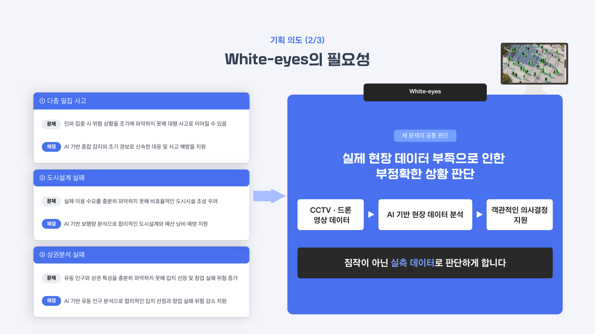
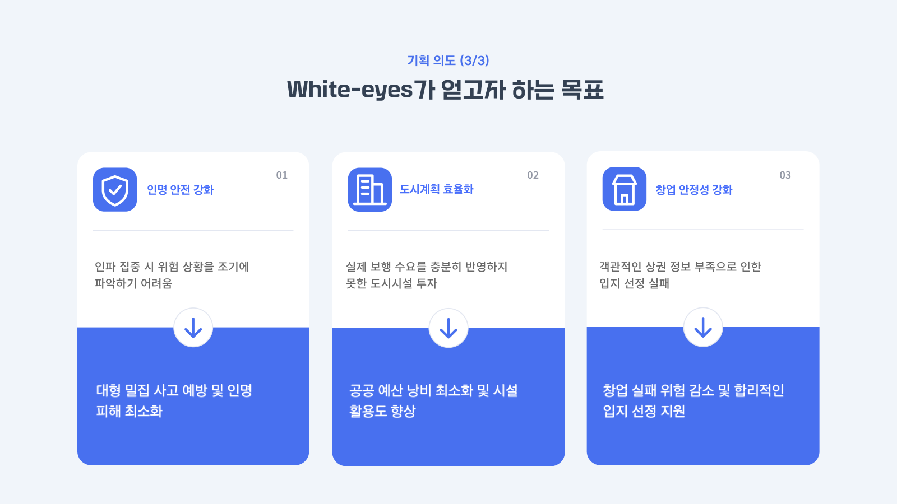
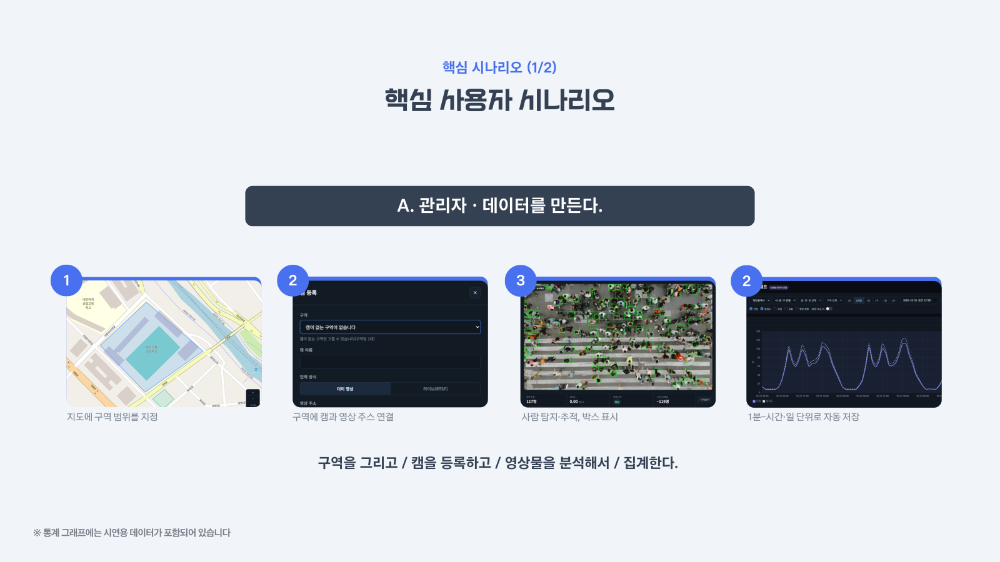
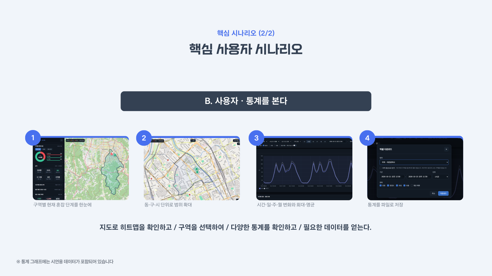
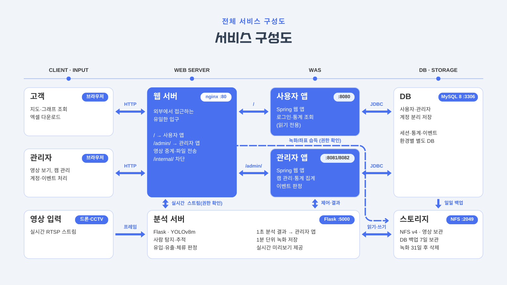

# 안녕하세요, 이규찬입니다 👋

**Backend Developer** — Java·Spring Boot 백엔드와 Python Flask 분석 서버를 다룹니다.
드론·CCTV 영상 기반 관제 시스템을 팀 프로젝트로 두 번 개발했고, 이슈 → 브랜치 → PR → 코드 리뷰 흐름으로 협업합니다.

## 🛠 Tech Stack

## 👁️ White-eyes (화이트 아이즈)

> 드론·CCTV 영상에서 사람을 찾아 세고, 구역별 **인구 밀집도**를 통계와 경보로 보여 주는 관제 서비스

| | |
| --- | --- |
| 기간 · 팀 | 2026.10.06 ~ 11.23 (7주) · 6명 |
| 내 역할 | **구역·캠 관리 · 실시간 화면·다시보기 · 대시보드 지도** (Spring 관리자 앱) |
| 기술 스택 | Java 17 · Spring Boot · JPA · MySQL 8 · Thymeleaf · Leaflet · Python Flask · YOLOv8m · Docker · nginx |
| 저장소 | [white-eyes1](https://github.com/white-eyes1) (spring · flask · docs · deploy · assets) |

 

### 흐름

드론·CCTV 영상 → **사람 탐지·추적**(VisDrone YOLOv8m + PointTracker) → **구역별 밀집도**(명/㎡) → 혼잡 3단계 경보 · 시간·일·주·월 통계 · 엑셀 · 영상 다시보기

 

### 시스템 구성

### AI 모델 성능 (사진 120장, 사람 3,263명 기준)

| 지표 | 결과 |
| --- | --- |
| 인원 집계 일치도(상관계수) | **0.93** |
| 정밀도 / 재현율 (IoU 0.5) | **82%** / 53% |
| 추적 번호가 붙은 박스 | 평균 90.9% (영상 13개, 83.7~95.5%) |

세어진 인원은 실제의 약 60~65%라서 화면에서는 '추정 인원'과 상대 혼잡 지표로만 씁니다.

### 내가 맡은 기능

| 영역 | 구현 내용 |
| --- | --- |
| 구역 관리 | 지도에 다각형을 그려 구역을 등록하면 면적(㎡)과 소속 동이 자동 계산됩니다(JTS). 다각형 수정은 같은 동 안에서만 허용하고, 동서남북 이웃 구역을 지정하면 반대쪽에도 자동 반영됩니다. |
| 캠 관리 | 구역당 캠 1대 규칙, 더미·라이브 입력 방식 선택, 가동·정지, 정지 상태에서만 수정 |
| 실시간 보기 · 다시보기 | 박스가 그려진 라이브 영상, 통계 그래프의 한 점이나 이벤트에서 그 시각의 녹화로 바로 이동, 탐지 박스 켜고 끄기, 녹화 30일 보관 |
| 대시보드 지도 | Leaflet + OpenStreetMap 지도에 구역 핀과 혼잡 단계 색(정상·주의 0.7명/㎡·위험 1.5명/㎡) |
| 캠 카드 미리보기 | 캠 카드 최대 16장을 연속 영상 대신 2초마다 정지 화면으로 갱신 |

### 트러블슈팅

| 문제 | 원인 | 해결 |
| --- | --- | --- |
| 캠 카드 16장을 띄우면 다른 요청이 막힘 | 카드마다 끊기지 않는 영상(MJPEG) 연결을 열어 브라우저의 도메인당 동시 연결 수 제한에 걸림 | 최신 프레임 JPEG를 2초마다 받고, 보이는 카드만·탭이 숨겨지면 멈춤 |
| 사람 수를 거의 못 세고 추적 번호가 끊김 | 일반 탐지 모델이 드론 부감 영상에 맞지 않음 | VisDrone YOLOv8m + PointTracker로 교체, 사진·영상으로 직접 비교 (탐지율 23% → 65%) |
| 캠을 가동해도 '현재 인원'이 한참 안 바뀜 | 1분 통계가 저장될 때까지 값이 없음 | 현재 인원은 메모리 누적기에서 5초마다 읽음 (최대 70초 지연 해소) |

## 📂 Projects

| 프로젝트 | 설명 | 내 역할 | 링크 |
| --- | --- | --- | --- |
| **White-eyes**   2026.10 ~ 11 · 6인 | 드론·CCTV 영상으로 구역별 인구 밀집도를 분석하고 통계·경보로 보여 주는 관제 서비스 (Spring Boot 앱 2개 + Flask 분석 서버) | 구역·캠 관리, 실시간 보기·다시보기, 대시보드 지도 | [white-eyes1](https://github.com/white-eyes1) · [소개](#️-white-eyes-화이트-아이즈) |
| **Obsidian Shield**   2026.06 ~ 07 · 5인 | 드론·CCTV 영상을 AI(객체 탐지 + 얼굴 인식)로 분석해 인물을 식별하고 이동 경로를 추적하는 실시간 관제 시스템 | 회원 서비스(가입·로그인 규칙, 입력 검증) | [Kanabig/obsidian-shield](https://github.com/Kanabig/obsidian-shield) |

## 🎓 Education

- K-디지털 트레이닝 — AIoT 기반 드론 영상 관제시스템 프로젝트 개발 (DW아카데미학원 5회차, 2026.04 ~ 2026.11, 1,120시간)
- 학점은행제 경영학과 (2025.10 ~ 2026.10, 전문학사 취득예정)

## 📝 Notes

배운 내용은 과목별로 정리하고, 막혔던 문제는 트러블슈팅으로 기록합니다. (Java · Python · Spring · Docker · Git · Linux · 서버 구축 등)
